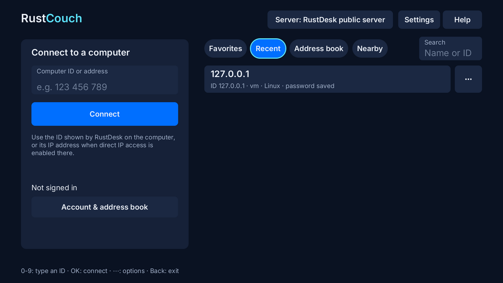
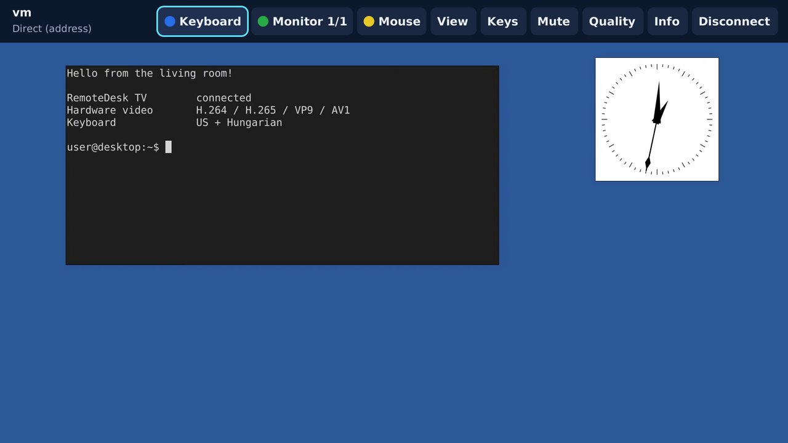
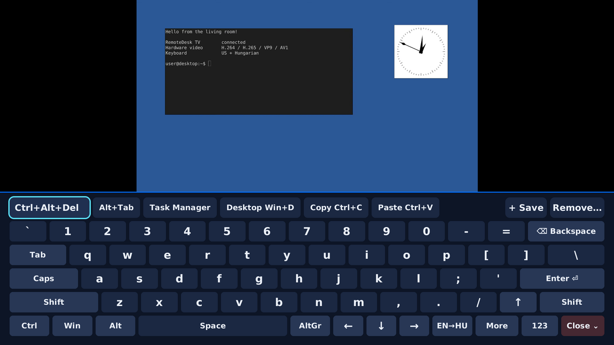
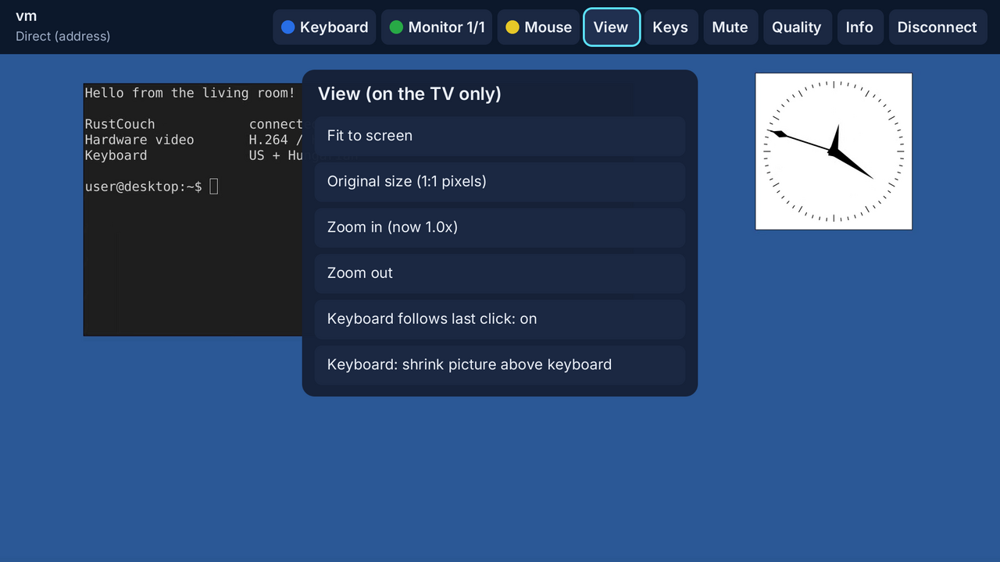

# RustCouch

**A community RustDesk-compatible remote desktop client for LG webOS TVs (webOS 5.x and newer).**
Control your Windows, Linux or macOS computer, running the normal unmodified RustDesk app, from the
sofa with the Magic Remote, a regular remote, or a USB/Bluetooth mouse and keyboard.


> **Status:** tested on an **LG C3** with a Windows RustDesk host: connecting, Magic Remote, remote
> buttons, hardware video, keyboard shrink and zoom work. Other models, webOS versions and Developer
> Mode installs still need reports: see [docs/COMPATIBILITY.md](docs/COMPATIBILITY.md) and
> [docs/NONROOT_CHECKLIST.md](docs/NONROOT_CHECKLIST.md).

Not affiliated with or endorsed by RustDesk or LG. Formerly called "RemoteDesk TV" (same app,
same app ID: updates and saved settings carry over).

## Install and update with the Homebrew Channel

RustCouch has its own [webOS Homebrew Channel](https://github.com/webosbrew/webos-homebrew-channel)
catalog, updated automatically with every release. Other installers that read Homebrew Channel
repositories, such as [Glasshouse](https://github.com/rorygallagher2024/glasshouse), can use it too:

```
https://raw.githubusercontent.com/danzig666/webos-rustdesk-client/homebrew-repo/apps.json
```

1. In the Homebrew Channel: **Settings → Add repository**, enter the URL above.
2. **RustCouch** appears in the app list: open it and choose **Install**.
3. Updates: when a new version is out, RustCouch shows **Update … available** on its Home
   screen; it opens the Homebrew Channel, where the app's page offers **Update**.

Already installed from an `.ipk`? **Settings → Add the RustCouch catalog to the Homebrew Channel**
opens the Homebrew Channel with the URL filled in. Other ways to install (Dev Manager, SSH,
Developer Mode with `ares-install`) are in [Install](#install) below.

## Screenshots

| | |
|---|---|
|  |  |
| Home: connect by ID or address, favourites, recent computers | Session toolbar (Back): keyboard, monitor, mouse/arrows, view, keys, quality |
|  |  |
| On-screen keyboard (Blue) with the picture shrunk above it | View menu: fit, 1:1, zoom (also with hardware decoding) |

Captured from the desktop build of the app connected to a stock RustDesk 1.5.0 host; on the TV
the screens look the same.

## Features

* Connect by RustDesk **ID** (public server or your **self-hosted** server, as separate profiles) or
  by **direct IP**. Password login, optional "Remember password?", 2FA, remote approval.
* **Hardware video decoding** (H.264, H.265, VP9, AV1) through the TV's Starfish media pipeline, so
  the picture can still be shrunk and zoomed; NDL DirectMedia and software VP9/VP8 as fallbacks.
  Remote **audio** with mute.
* TV-first controls: Magic Remote pointing; **Red** right click, **Green** next monitor,
  **Yellow** mouse/arrow mode, **Blue** keyboard, **Back** toolbar. Everything is also reachable
  without colour buttons.
* Full **on-screen keyboard**: US English and **Hungarian** layouts, Ctrl/Alt/AltGr/Shift/Win
  (once or locked), F1–F12, navigation keys, numpad, per-computer shortcut row, Ctrl+Alt+Del.
* **USB/Bluetooth keyboards**: typing, shortcuts with held modifiers (Alt+Tab, Win+E, Ctrl+C,
  Shift+arrows) and special keys are forwarded to the computer.
* Fit / 1:1 / zoom views, keyboard shrink or overlay, monitor picker, quality controls,
  lock-on-disconnect.
* Leaving the app disconnects by default (one-press Reconnect on return); optional
  keep-connected; 30-second automatic reconnect after unexpected drops.
* **Nearby**: finds the RustDesk computers on your home network, and **Wake-on-LAN** wakes them.
* **Public server sign-in** with Google, GitHub or Microsoft via a QR code on your phone (the public
  RustDesk server requires it); accounts and address book when your server provides them.
* Out of scope by design: file transfer, clipboard sync, chat, recording, terminal, tunnels,
  multiple sessions, incoming control of the TV.

## Known limitations

* **Some function keys never reach the app.** webOS keeps certain keyboard keys for the TV itself
  before any app sees them: on an LG C3, **F2, F11 and F12** change TV settings (for example
  volume/mute) instead of reaching the computer. Other F-keys (F1, F6, F8, F9…) are forwarded.
  Use the on-screen keyboard's **More** page (Blue button) for the missing ones.
* **Esc on a keyboard arrives as the remote's Back button** (same key code from the TV). During a
  session it is sent to the computer as Esc while you are typing (for 10 s after the last key);
  otherwise Back opens the toolbar. Ctrl+Alt+Shift+Space always opens the toolbar.
* Tested on one TV model so far (LG C3); reports from other models are welcome.

## Install

Download the `.ipk` from [Releases](https://github.com/danzig666/webos-rustdesk-client/releases), then:

* Rooted TV / Homebrew Channel: [docs/INSTALL_ROOTED.md](docs/INSTALL_ROOTED.md)
* Developer Mode (non-rooted): [docs/INSTALL_DEVMODE.md](docs/INSTALL_DEVMODE.md)
* Windows helpers: [tools/](tools/) (`Install-RustCouch.ps1`, `Get-RustCouchLogs.ps1`, `Test-RustCouch.ps1`)

Then read the [user guide](docs/USER_GUIDE.md).

## How it works

Rust, three crates on top of RustDesk 1.5.0's own `hbb_common` and `base` libraries (pinned
submodule, unmodified):

* `rdtv-core`: rendezvous, hole punch/relay, key exchange, login and session loop, ported from
  upstream's client; profiles, storage, input messages, reconnect policy, account API.
* `rdtv-media`: NDL hardware decoding (`dlopen`), libvpx, libopus, decode pipeline.
* `rdtv-app`: native SDL2 TV interface (webosbrew SDL-webOS), on-screen keyboard, session view.

See [docs/ARCHITECTURE.md](docs/ARCHITECTURE.md) and [docs/DECISIONS.md](docs/DECISIONS.md).

## Build

GitHub Actions builds, audits, smoke-tests and packages every push. Local builds:
[docs/BUILDING.md](docs/BUILDING.md).

## Documentation

| | |
|---|---|
| [USER_GUIDE](docs/USER_GUIDE.md) | buttons, keyboard, views, profiles, reconnect |
| [FEATURE_MATRIX](docs/FEATURE_MATRIX.md) | owner-approved scope and status of every feature |
| [COMPATIBILITY](docs/COMPATIBILITY.md) | what was tested where, known limitations, release gates |
| [TESTING](docs/TESTING.md) | automated and manual test report |
| [NONROOT_CHECKLIST](docs/NONROOT_CHECKLIST.md) | hardware verification checklist for testers |
| [DECISIONS](docs/DECISIONS.md) / [ARCHITECTURE](docs/ARCHITECTURE.md) | owner decisions, implementation defaults, design |
| [SOURCES](docs/SOURCES.md) | every reference used, with evidence status |
| [SECURITY](docs/SECURITY.md) | storage, trust and privacy behaviour |
| [LICENSING](docs/LICENSING.md) | licence and naming review |
| [UPSTREAM_UPDATE](docs/UPSTREAM_UPDATE.md) | moving to a newer RustDesk release |

## License

GNU AGPL-3.0 (see [LICENSE](LICENSE)). It includes code ported from RustDesk (AGPL-3.0).
Third-party notices: [THIRD-PARTY-NOTICES.txt](THIRD-PARTY-NOTICES.txt).
