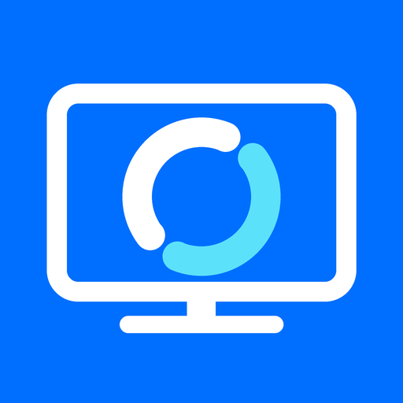

# RemoteDesk TV

**A community RustDesk-compatible remote desktop client for LG webOS TVs (webOS 5.x and newer).**
Control your Windows, Linux or macOS computer, running the normal unmodified RustDesk app, from the
sofa with the Magic Remote, a regular remote, or a USB/Bluetooth mouse and keyboard.

> **Status:** tested on an **LG C3** with a Windows RustDesk host: connecting, Magic Remote, remote
> buttons, hardware video, keyboard shrink and zoom work. Other models, webOS versions and Developer
> Mode installs still need reports: see [docs/COMPATIBILITY.md](docs/COMPATIBILITY.md) and
> [docs/NONROOT_CHECKLIST.md](docs/NONROOT_CHECKLIST.md).

Not affiliated with or endorsed by RustDesk or LG.

## Features

* Connect by RustDesk **ID** (public server or your **self-hosted** server, as separate profiles) or
  by **direct IP**. Password login, optional "Remember password?", 2FA, remote approval.
* **Hardware video decoding** through the TV's NDL DirectMedia (H.264, H.265, VP9, AV1), with
  software VP9/VP8 fallback. Remote **audio** with mute.
* TV-first controls: Magic Remote pointing; **Red** right click, **Green** next monitor,
  **Yellow** mouse/arrow mode, **Blue** keyboard, **Back** toolbar. Everything is also reachable
  without colour buttons.
* Full **on-screen keyboard**: US English and **Hungarian** layouts, Ctrl/Alt/AltGr/Shift/Win
  (once or locked), F1–F12, navigation keys, numpad, per-computer shortcut row, Ctrl+Alt+Del.
* Fit / 1:1 / zoom views, keyboard shrink or overlay, monitor picker, quality controls,
  lock-on-disconnect.
* Leaving the app disconnects by default (one-press Reconnect on return); optional
  keep-connected; 30-second automatic reconnect after unexpected drops.
* Accounts and address book when your server provides them.
* Out of scope by design: file transfer, clipboard sync, chat, recording, terminal, tunnels,
  multiple sessions, incoming control of the TV.

## Install

Download the `.ipk` from [Releases](https://github.com/danzig666/webos-rustdesk-client/releases), then:

* Rooted TV / Homebrew Channel: [docs/INSTALL_ROOTED.md](docs/INSTALL_ROOTED.md)
* Developer Mode (non-rooted): [docs/INSTALL_DEVMODE.md](docs/INSTALL_DEVMODE.md)
* Windows helpers: [tools/](tools/) (`Install-RemoteDeskTV.ps1`, `Get-RemoteDeskTVLogs.ps1`, `Test-RemoteDeskTV.ps1`)

Then read the [user guide](docs/USER_GUIDE.md).

## How it works

Rust, three crates on top of RustDesk 1.5.0's own `hbb_common` and `base` libraries (pinned
submodule, unmodified):

* `rdtv-core`: rendezvous, hole punch/relay, key exchange, login and session loop, ported from
  upstream's client; profiles, storage, input messages, reconnect policy, account API.
* `rdtv-media`: NDL hardware decoding (`dlopen`), libvpx, libopus, decode pipeline.
* `rdtv-app`: native SDL2 TV interface (webosbrew SDL-webOS), on-screen keyboard, session view.

See [docs/ARCHITECTURE.md](docs/ARCHITECTURE.md) and [docs/DECISIONS.md](docs/DECISIONS.md).

## Build

GitHub Actions builds, audits, smoke-tests and packages every push. Local builds:
[docs/BUILDING.md](docs/BUILDING.md).

## Documentation

| | |
|---|---|
| [USER_GUIDE](docs/USER_GUIDE.md) | buttons, keyboard, views, profiles, reconnect |
| [FEATURE_MATRIX](docs/FEATURE_MATRIX.md) | owner-approved scope and status of every feature |
| [COMPATIBILITY](docs/COMPATIBILITY.md) | what was tested where, known limitations, release gates |
| [TESTING](docs/TESTING.md) | automated and manual test report |
| [NONROOT_CHECKLIST](docs/NONROOT_CHECKLIST.md) | hardware verification checklist for testers |
| [DECISIONS](docs/DECISIONS.md) / [ARCHITECTURE](docs/ARCHITECTURE.md) | owner decisions, implementation defaults, design |
| [SOURCES](docs/SOURCES.md) | every reference used, with evidence status |
| [SECURITY](docs/SECURITY.md) | storage, trust and privacy behaviour |
| [LICENSING](docs/LICENSING.md) | licence and naming review |
| [UPSTREAM_UPDATE](docs/UPSTREAM_UPDATE.md) | moving to a newer RustDesk release |

## License

GNU AGPL-3.0 (see [LICENSE](LICENSE)). It includes code ported from RustDesk (AGPL-3.0).
Third-party notices: [THIRD-PARTY-NOTICES.txt](THIRD-PARTY-NOTICES.txt).
